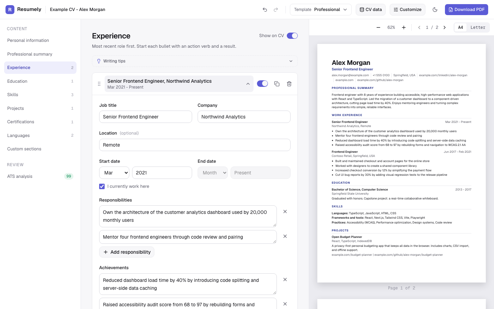
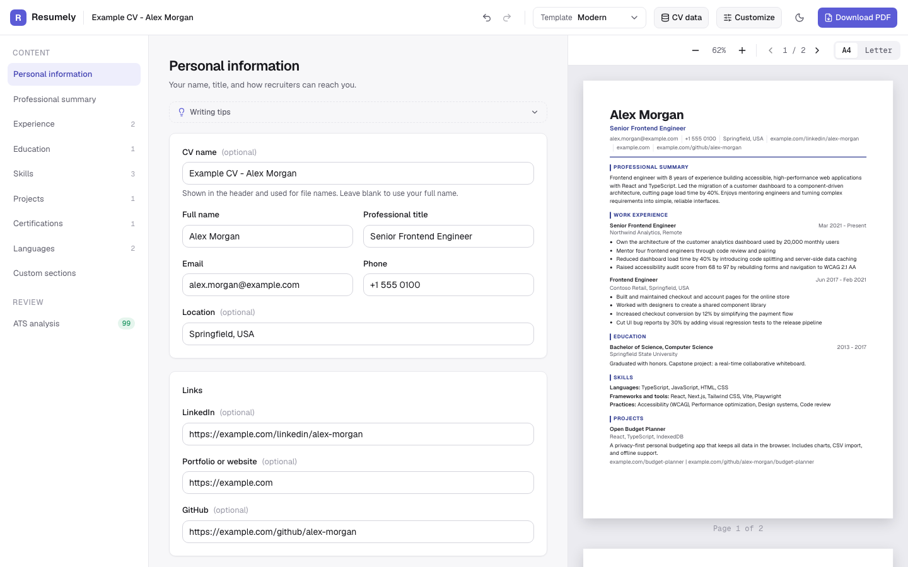
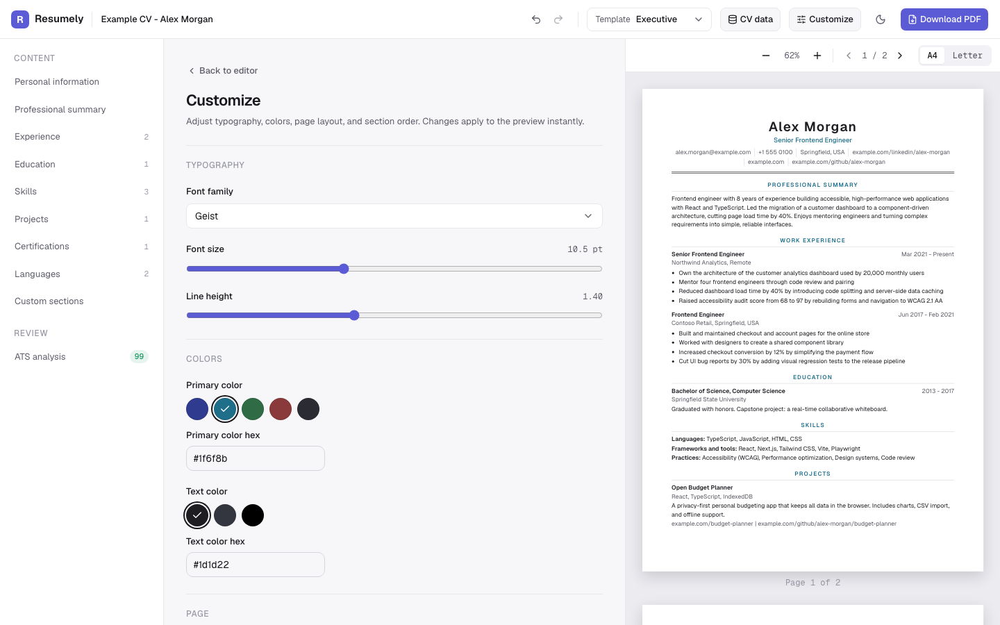
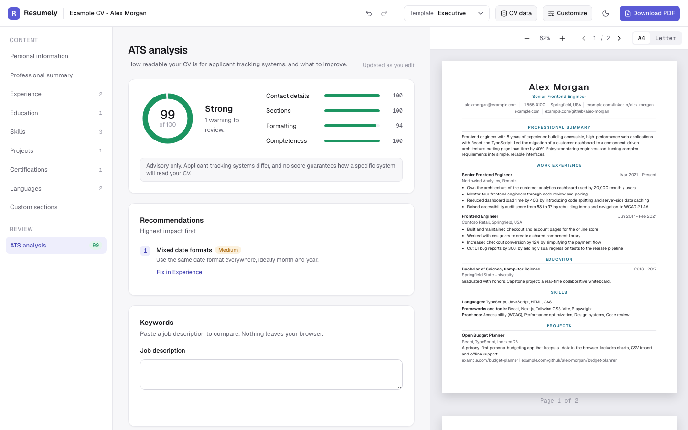
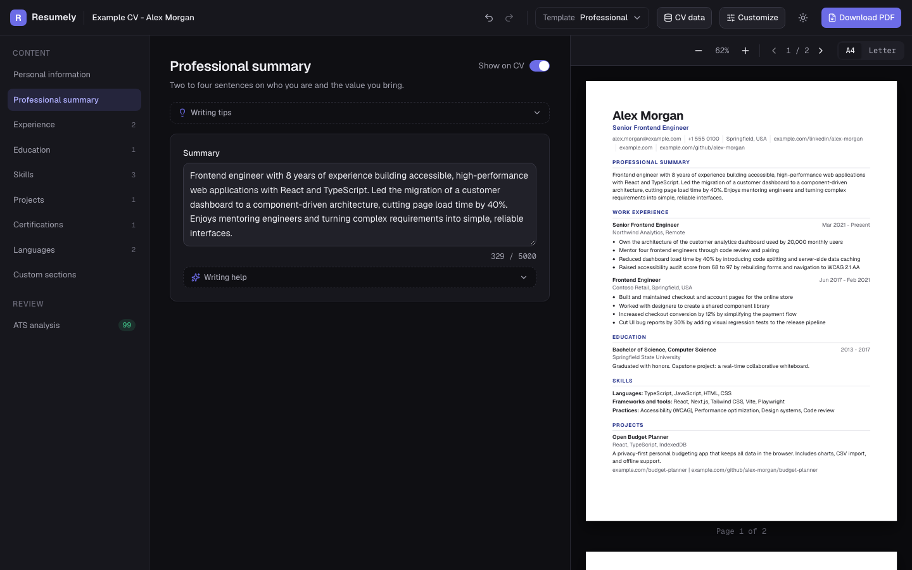
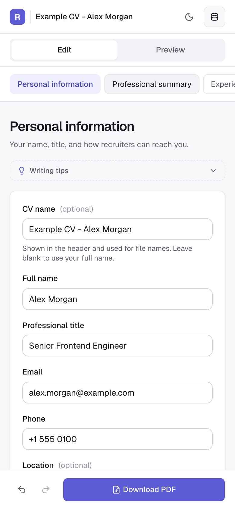
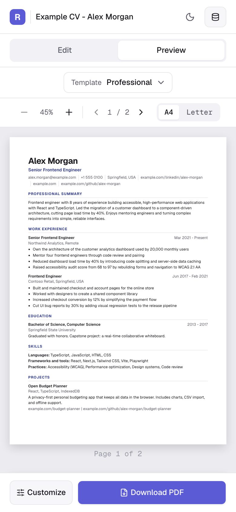

# Resumely

Build a professional, ATS-friendly CV in your browser. Write your content, pick a template, see the
finished document update as you type, check how well applicant tracking systems can read it, and
download a polished PDF with selectable text.

Resumely has no accounts and no database. Your CV is saved only in your browser's LocalStorage. The
only time it leaves your device is when you ask for a PDF, which the server renders and returns
without storing anything.



## Why Resumely

Many CV builders produce documents that look good but parse badly. They use multi-column tables,
text baked into images or non-standard headings, so the recruiting software that screens
applications drops or scrambles the content. Others lock the PDF download behind an account or a
subscription.

Resumely keeps both concerns in one place:

- **Readable by machines:** every template uses semantic HTML, standard section headings and real
  text, so the CV survives an applicant tracking system (ATS).
- **Pleasant for people:** six clean layouts, live preview and fine-grained styling make it easy to
  produce something you're happy to send.
- **Private by default:** no sign-up, no tracking, no server-side storage, and no AI service that
  sees your data.

## Key features

### Editing

- **Nine content sections:** personal information (with an optional profile photo), professional
  summary, experience, education, skills, projects, certifications, languages and custom sections.
- **Entry management:** add, edit, duplicate, delete, hide and reorder entries. Reordering works by
  drag and drop or with the keyboard.
- **Section control:** show or hide whole sections, and change their order on the CV.
- **Undo and redo:** step through up to 100 edits with the buttons or `Cmd/Ctrl+Z` and
  `Cmd/Ctrl+Shift+Z`.
- **Inline validation:** clear error messages tied to each field, such as an incomplete email
  address.

### Templates and preview

- **Six templates:** Professional, Modern, Executive, Developer, Minimal and Compact. Modern and
  Executive can show a profile photo; the other four are text only.
- **Live multi-page preview:** pages are paginated as on paper, with key blocks kept whole.
- **A4 and US Letter:** switch paper size at any time.
- **Zoom and page navigation:** from 50% to 150%, with a fit-to-width default.

### Customization

- Font family (Geist, Inter, Georgia, Arial), font size and line height.
- Primary and text colors from curated swatches or any hex value.
- Page margins, section spacing and page size.
- Section order by drag and drop, plus a show/hide toggle for each section.

### ATS analysis

- **A score from 0 to 100** with a breakdown for contact details, sections, formatting and
  completeness.
- **Ranked recommendations**, each with a link straight to the section that needs work.
- **Job description matching:** paste a job ad to see which of its keywords your CV covers and
  which are missing. Keywords are extracted locally with deterministic rules. The job description
  is never stored or sent anywhere.
- The analysis is advisory, and the app says so: no score can guarantee how a particular ATS will
  read a CV.

### Writing help (built in, no AI)

- Summary examples and professional phrases you can insert with one click.
- Action verbs by category and achievement examples for experience bullets.
- Skill and keyword suggestions grouped by area.
- Writing tips for every section.

### Your data

- **Autosave:** every change is saved to LocalStorage and restored when you come back.
- **Corrupted-data recovery:** if a saved CV can't be read, Resumely starts a fresh one and keeps
  the unreadable copy aside instead of overwriting it.
- **JSON import and export:** download your CV as a JSON file and import it again later, on any
  device. Imports are validated, and you confirm before your current CV is replaced.
- **Example CV** to explore the app, and **Clear stored data** with confirmation.

### PDF download

- Rendered on the server with headless Chromium (Playwright) from the same templates as the
  preview, so the PDF matches what you see.
- Selectable text, clickable links, correct A4 or Letter page size, and no stray blank pages.
- The request is validated and size-limited, and rendering has a 20-second time limit.

### Responsive and accessible

- **Desktop:** a three-panel layout with the sections sidebar, the editor and the live preview.
- **Tablet and small laptop:** Edit and Preview tabs.
- **Phone:** a dedicated layout with a slim header and a bottom action bar.
- Light and dark themes.
- Full keyboard support, visible focus, labelled controls, and screen-reader announcements for
  undo/redo, reordering and paging.

## Screenshots

### Editor with live preview


### Templates



### Customization



### ATS analysis



### Dark mode



### Mobile

<p>
  
  &nbsp;&nbsp;
  
</p>

## Technologies used

| Area | Technology |
|---|---|
| Framework | [Next.js 16](https://nextjs.org) (App Router) with [React 19](https://react.dev) |
| Language | [TypeScript](https://www.typescriptlang.org) in strict mode |
| Styling | [Tailwind CSS v4](https://tailwindcss.com) with CSS-first theme tokens |
| UI components | [shadcn/ui](https://ui.shadcn.com) on [Base UI](https://base-ui.com), [Lucide](https://lucide.dev) icons |
| Forms and validation | [React Hook Form](https://react-hook-form.com) and [Zod](https://zod.dev) |
| Drag and drop | [dnd-kit](https://dndkit.com) |
| PDF generation | [Playwright](https://playwright.dev) (headless Chromium) in a Next.js route handler |
| Theming and notifications | [next-themes](https://github.com/pacocoursey/next-themes) and [Sonner](https://sonner.emilkowal.ski) |
| Dates | [date-fns](https://date-fns.org) |
| Testing | [Playwright Test](https://playwright.dev/docs/test-intro) end-to-end suite |
| Persistence | Browser LocalStorage (no database) |

## Getting started

### Prerequisites

- Node.js 20.9 or later
- npm

### Install and run

```bash
git clone https://github.com/labrahimiimrane/Resumely.git
cd Resumely
npm install
npx playwright install chromium   # browser used for PDF rendering and the test suite
npm run dev
```

Then open [http://localhost:3000](http://localhost:3000). Use **CV data → Load example CV** to see
a filled-in CV straight away.

### Scripts

| Command | What it does |
|---|---|
| `npm run dev` | Start the development server at http://localhost:3000 |
| `npm run build` | Create a production build (includes the TypeScript check) |
| `npm run start` | Serve the production build |
| `npm run lint` | Run ESLint |
| `npm run test:browser` | Build the app, serve it on port 3210, and run the end-to-end suite in Chromium |

## Project structure

```text
app/                 Routes: the editor (/), the print page used for PDFs, and POST /api/pdf
components/
  layout/            Header, section navigation, template selector, CV data menu, mobile bar
  editor/            Section forms, entry lists, writing help
  preview/           Live preview, pagination, zoom and page controls
  templates/         The six CV templates
  customize/         Typography, color, page and section-order settings
  ats/               ATS score, checks, recommendations and keyword matching
  ui/                shadcn/ui primitives
hooks/               CV state with undo/redo and autosave, shared hooks
lib/                 Validation schemas, ATS rules, pagination, storage, PDF rendering
types/               Shared TypeScript types
e2e/                 Playwright end-to-end tests
docs/screenshots/    Images used in this README
```

## Testing

The end-to-end suite drives the real production build in Chromium the way a user would. It covers
editing, entry management, undo/redo, all six templates, preview, customization, ATS analysis,
autosave and recovery, JSON import/export, PDF downloads and API errors, and the phone, tablet and
desktop layouts.

```bash
npm run test:browser
```

## Deployment

Resumely needs a Node.js server runtime because the PDF route renders documents with Playwright. It
cannot be deployed as a static export. Whichever host you choose must be able to run headless
Chromium:

```bash
npm run build
npx playwright install --with-deps chromium
npm run start
```

The app uses no database, environment variables or external services.
